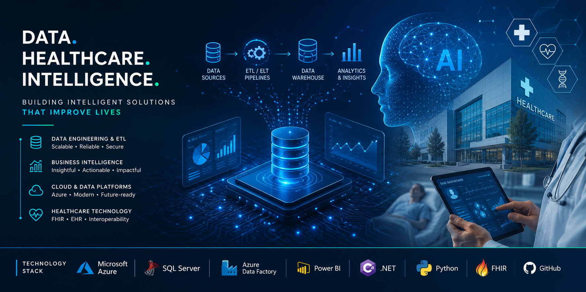

### Senior Data Platform & BI Engineer | Secure Data Engineering | Data Governance

I design and build enterprise data platforms where security and governance are built into the architecture from the start, not added later. My work spans cloud ETL/ELT on Azure, SQL Server, and Power BI, with a focus on retail, healthcare, and education.

### 🚀 What I'm Working On
- 🔄 Cloud-native ETL/ELT pipelines with Azure Data Factory, SSIS and PowerShell
- 📊 Enterprise BI solutions with Power BI, SQL Server & Azure Delta Lake.
- ☁️ Secure, governed data platforms aligned to NIST CSF 2.0
- 🌐 Healthcare data transformation to HL7 FHIR
- 📚 Exploring AI, Cybersecurity & Modern Data Engineering.

### 🚀 Featured Projects

| Project | Description |
|---------|-------------|
| 🏥 [Healthcare Transformation Engine](https://github.com/Purplewells/HealthcareTransformationEngine) | Metadata-driven ETL engine for transforming data into HL7 FHIR resources. |
| 🛡️ [Retail Risk Assessment](https://github.com/Purplewells/retail-risk-assessment-nist-csf) | Retail Risk Assessment (NIST CSF 2.0) |
| 🎓 [NextSchoolTask](https://github.com/Purplewells/NextSchoolTask) | School management and task execution platform. |
| ♻️ [WasteCall](https://github.com/Purplewells/WasteCall) | Waste reporting and collection management platform. |
| 💊 [Replenix](https://github.com/Purplewells/Replenix) | Merchandise management, inventory & pricing solution. |

### 💻 Tech Stack & Toolkit
- C# / .NET / ASP.NET Core
- PowerShell (Automation Scripting)
- SQL Server • Power BI • Azure Data Factory • SSIS Integration
- Apache Airflow • Data Engineering 
- Data Governance • Risk Management • Cybersecurity • Compliance
- DevOps • Docker
  
